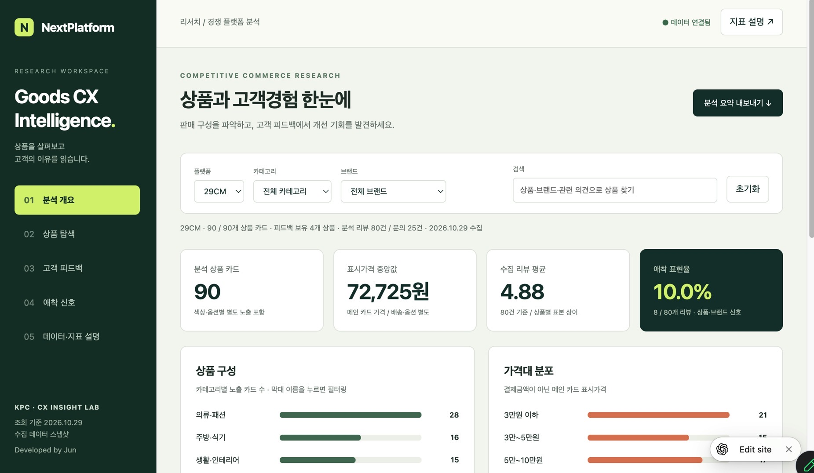

# Goods CX Intelligence

**경쟁 굿즈 플랫폼의 상품 구성과 고객경험을 분석하는 데이터 대시보드**입니다. KPC 고객경험 설계 및 관리 과정에서 29CM의 상품·고객 피드백을 수집하고, 상품 탐색부터 구매 이유·개선 요구·애착 표현까지 연결하는 실습 결과물로 제작했습니다.

- 개발: **Jun · NextPlatform**
- 구현: **ChatGPT Codex / ChatGPT Sites**
- 데이터 기준일: **2026년 10월 29일**
- 버전: **1.0.0**
- [ChatGPT Sites 앱 열기](https://goods-cx-intelligence.jun-nextplatform.chatgpt.site/) — 현재 본인 전용, ChatGPT 로그인 필요

> **공개 저장소 버전:** 앱 코드·문서·사용자 제공 화면과 **합성 예제 데이터**를 포함합니다. 실제 고객 리뷰·문의 데이터와 실제 데이터를 담은 JSON은 공개하지 않았습니다. 아래 90개 상품·105개 피드백 등의 수치는 초기 Sites 앱의 구현 범위 설명입니다.

## 프로젝트 배경

학습자가 자신의 브랜드와 제품을 정의하고 경쟁 제품을 조사한 뒤, 타겟 고객의 니즈에 맞는 경험을 설계하는 과정을 지원합니다. 29CM의 취향 큐레이션과 뮷즈의 문화 콘텐츠 상품화 방식 비교에서 출발해, 실제 상품과 공개 고객 피드백을 분석하는 앱으로 구현했습니다.

현재 앱의 정량 데이터는 **29CM만 포함**합니다. 뮷즈는 기획 단계의 비교 사례이며 정량 데이터는 아직 수집하지 않았습니다.

## 핵심 기능

| 메뉴 | 기능 |
| --- | --- |
| 분석 개요 | 상품 수, 가격 중앙값, 리뷰 평균, 애착 표현율, 카테고리·가격대 분포 |
| 상품 탐색 | 카테고리·브랜드·검색 필터, 가격·애착 표현율 정렬, 페이지 이동 |
| 상품 상세 | 가격·찜 표시·배송·큐레이션 문구, 리뷰·문의 요약, 출처 링크 |
| 고객 피드백 | 별점 분포, 주제 빈도, 개선 의견·5점 속 개선 의견·애착 신호·3점 이하·문의 필터 |
| 애착 신호 | 재구매 경험·구매 의향·브랜드 선호, 상품별·카테고리별 집계와 근거 리뷰 |
| 데이터·지표 설명 | 원본 CSV 다운로드, 계산법, 수집 범위 및 해석 기준 |
| 결과 내보내기 | 현재 필터에 따른 상품·피드백·애착 지표·요약 CSV 다운로드 |

데스크톱과 모바일 폭에 맞춰 화면을 배치합니다. 외부 UI·차트 라이브러리 없이 HTML/CSS/JavaScript로 구현했습니다.

## 초기 Sites 앱의 데이터 범위

| 항목 | 범위 |
| --- | --- |
| 상품 | 메인 ‘더보기’ 이전 30개 큐레이션 영역의 상품 카드 **90개**, 브랜드 **42개** |
| 리뷰 | 4개 상품의 리뷰 **80건** |
| 상품 문의 | 온앤온 문의 **25건**: 공개 5건, 비밀글 목록 정보 20건 |
| 피드백 합계 | **105건** |

| 대상 상품 | 상품 ID | 수집 리뷰 / 표시 전체 | 수집 방식 |
| --- | --- | --- | --- |
| 온앤온 퍼 배색 구스 다운 | 3620091 | 38 / 38 | 추천순 2페이지 전체 |
| GBH 핸드 워시·핸드 타월 기프트 세트 | 1671349 | 20 / 1,013 | 추천순 첫 페이지 표본 |
| 에포크 오발 플레이트 | 3433354 | 10 / 127 | 추천순 앞 10건 표본 |
| 인탠저블 MEMORY VITRINE LIGHT | 4201719 | 12 / 12 | 전체 |

색상·옵션에 따른 별도 상품 카드가 포함됩니다. 고유 모델 수나 판매량을 의미하지 않습니다. 나머지 **86개 상품의 피드백은 미수집**입니다. 가격·관심 수는 수집 시점의 표시값이며 옵션·배송·쿠폰 적용에 따라 결제금액은 달라질 수 있습니다.

### 공개 저장소의 제공 데이터

- `dist/example_products.csv`: 실제 상품과 무관한 합성 상품 **12개**.
- `dist/example_feedback.csv`: 실제 고객과 무관한 합성 리뷰 **8건**, 가상 문의 **3건**.
- `dist/data.json`: 위 예제에서 생성한 실행용 JSON.

실제 수집 CSV와 실제 리뷰 주석은 이 저장소에 포함하지 않습니다. 실행 화면에 합성 예제임을 표시합니다. README 상단 이미지는 사용자가 제공한 초기 Sites 앱 화면이므로 예제 실행 수치와 다릅니다.

원본 Sites 피드백은 분석자가 작성한 요약이며 비밀 문의 본문·개인 식별 정보를 포함하지 않습니다. `R001` 등은 상품 안의 리뷰 순번으로, 다른 상품의 같은 번호를 동일 고객으로 연결할 수 없습니다.

## 애착 지표

```text
애착 표현율 (%) = 명시적 애착 신호가 있는 리뷰 수 / 수집 리뷰 수 × 100
```

초기 Sites 앱에서는 리뷰 요약과 직전 수집 원문을 검토해 **8개 리뷰**에 근거를 표시했습니다. 다음 수치는 당시 구현 범위입니다.

| 신호 | 기준 | 리뷰 수 |
| --- | --- | ---: |
| 재구매 경험 | 기존 사용 후 재구매·추가 구매 명시 | 4 |
| 구매 의향 | 향후 본인용·동일 브랜드 다른 상품 구매 의향 | 3 |
| 브랜드 선호 | 브랜드 선호 명시 | 1 |

초기 Sites 앱의 표현율은 **8 / 80 = 10.0%**입니다. 공개 예제는 **2 / 8 = 25.0%**이며 `dist/app.js`의 `SIGNALS`에는 가상 상품·리뷰의 합성 근거만 정의했습니다. 학습 모델이나 자동 감정 분석이 아니라 검토한 근거에 따른 주석입니다.

- 한 리뷰는 여러 신호가 있어도 분자에서 한 번만 계산합니다.
- Q&A·찜 수·별점은 계산에서 제외합니다.
- 카테고리는 신호 리뷰 수와 수집 리뷰 수를 각각 합산합니다. 상품별 비율의 단순 평균이 아닙니다.
- 미수집 상품은 **측정 불가**, 수집 리뷰에 표현이 없으면 **0%**로 구분합니다.
- 표본 규모와 수집 방식을 함께 표시합니다. 추천순 표본으로 전체 고객의 애착이나 상품 간 우열을 확정하지 않습니다.

이 지표는 **상품·브랜드에 관한 표현 신호**이며 개인별 플랫폼 충성도·NPS·검증된 심리척도가 아닙니다. 플랫폼 애착을 측정하려면 동의 기반 안정적 고객 ID, 주문·반품·방문 이력과 선호 설문 등이 추가로 필요합니다.

## 초기 구현의 오류 수정 및 공개 버전 보정 사항

| 항목 | 반영 내용 |
| --- | --- |
| 미수집과 0% 혼동 | 리뷰 미수집 상품은 애착 표현율을 측정 불가로 처리 |
| 집계 단위 | 문의를 리뷰 평균·애착 비율에서 제외. 상품 카드·모델·판매량 구분 |
| 카테고리 비율 | 상품별 비율 평균 대신 리뷰 분자·분모 합산 |
| 상품 연결 | 확인한 4개만 브랜드·고유 상품명·ID로 명시 매핑. 나머지는 카드 ID와 메인 출처 유지 |
| 요약의 대상 브랜드 | 온앤온 R008의 모호한 ‘다른 브랜드 상품’을 원문에 근거해 ‘온앤온의 다른 의류’ 구매 의향으로 보정. 원본 CSV 보존 |
| 별점만으로 불만 판단 | 5점 리뷰의 포장·배송·핏·마감 등 개선 의견도 별도 표시 |
| 선택 응답과 본문 차이 | 사이즈 응답과 요약을 함께 제공해 상충하는 표현 확인 |
| 로컬 절대 경로 | 변환 스크립트를 저장소 상대 경로와 명시 입력 인자로 변경 |
| 공개 데이터 범위 | 실제 고객 피드백을 제거하고 합성 예제·분석 주석으로 교체 |

`ISSUES`의 개선 의견도 검토 기반 분류입니다. 제품 결함 확정 건수나 전체 고객 불만율이 아닙니다.

## 기술 구성

- 프런트엔드: HTML5, CSS3, JavaScript
- 데이터: UTF-8 BOM CSV, JSON
- 데이터 변환: Python 3 표준 라이브러리
- 검증: Node.js 내장 모듈, JavaScript 문법 검사
- 실행: 정적 HTTP 서버. API 키·DB·외부 패키지 설치 불필요

```text
.
├── README.md
├── package.json
├── prepare_data.py
├── scripts/verify.mjs
├── docs/images/dashboard.jpg
└── dist/
    ├── index.html
    ├── style.css
    ├── app.js
    ├── data.json
    ├── example_products.csv
    └── example_feedback.csv
```

## 로컬 실행

```bash
git clone https://github.com/junsang-dong/kpc-261029-cx-ljw-intelligence.git
cd kpc-261029-cx-ljw-intelligence
python3 -m http.server 8000 --directory dist
```

브라우저에서 `http://localhost:8000`에 접속합니다. JSON을 `fetch`하므로 HTML을 `file://`로 직접 여는 방식은 사용하지 않습니다. npm 의존성 설치·빌드는 필요하지 않습니다.

### 데이터 재생성

```bash
python3 prepare_data.py
```

기본 실행은 합성 CSV를 JSON으로 변환합니다. 다른 로컬 CSV를 사용하려면 `--products`, `--feedback`, `--date`, `--output`을 지정합니다. 입력은 예제 CSV와 동일한 정규화 컬럼 구조여야 합니다. 상품 ID는 중복 없이 피드백에 연결되어야 하며 tags는 JSON 배열입니다. 기존 한국어 원본 CSV를 그대로 읽는 범용 수집기는 아닙니다. 애착·개선 의견 근거도 데이터에 맞춰 갱신해야 합니다. 재생성은 웹사이트에서 새 데이터를 수집하지 않습니다.

### 검증

Node.js가 설치된 환경에서 실행합니다.

```bash
node --check dist/app.js
node scripts/verify.mjs
```

합성 상품 12개·피드백 11건, 예제 평균 별점, 애착 신호 2건, 상품 ID 연결, 카테고리 집계, 미수집과 0%, 브랜드·카테고리·검색 필터, 화면 생성을 검사합니다.

초기 Sites 구현에서는 브라우저로 메뉴 이동·상품 상세·카테고리별 애착 집계·5점 속 개선 의견 필터도 확인했습니다.

## 배포와 한계

`dist`를 정적 웹 호스팅의 배포 디렉터리로 사용합니다. 이 저장소에 푸시했다고 GitHub Pages나 다른 호스팅이 자동 활성화되지는 않습니다.

현재는 수집 스냅샷 분석 앱입니다. 실시간 크롤링, CSV 업로드, DB/API 연결, 서버 감정 분석, 사용자 계정·플랫폼별 고객 식별 기능은 구현하지 않았습니다. 다른 플랫폼을 추가하려면 데이터와 매핑을 확장해야 합니다.

## 출처

- [29CM 메인](https://www.29cm.co.kr/)
- [온앤온 상품·리뷰·문의](https://www.29cm.co.kr/products/3620091)
- [GBH 기프트 세트](https://www.29cm.co.kr/products/1671349)
- [에포크 오발 플레이트](https://www.29cm.co.kr/products/3433354)
- [인탠저블 조명](https://www.29cm.co.kr/products/4201719)

카테고리·주제·애착 신호는 분석자 분류입니다. 데이터 행에도 출처가 있습니다. 상단 이미지는 사용자가 제공한 앱 화면입니다.

---

Developed by Jun · NextPlatform · Built with ChatGPT Codex · © 2026
